  <!-- Fixed Maroon Header (Capsule Render) -->
  
  
  <!-- Subtitle -->
  <h3 align="center">💻 CSE Student | 🤖 AI Explorer | 📊 Data Scientist</h3>
  
   
  
  <!-- Profile Views Counter -->
  

    

  <!-- Animated Typing Text (ফিরিয়ে আনা হয়েছে) -->
  

    

  <!-- Coding GIF -->
  

---

### 🛠️ Skills & Technologies

  

---

### 🐍 My Contributions

  <picture>
    <source media="(prefers-color-scheme: dark)" srcset="https://raw.githubusercontent.com/bughunter-404/bughunter-404/output/github-contribution-grid-snake-dark.svg">
    <source media="(prefers-color-scheme: light)" srcset="https://raw.githubusercontent.com/bughunter-404/bughunter-404/output/github-contribution-grid-snake.svg">
    
  </picture>

---

### 📫 Let's Connect

  
<i>"Data is the new oil, and machine learning is the combustion engine." 🚀</i>

  
I am always open to discussing new projects, creative ideas or opportunities to be part of your visions.

  
  
  

